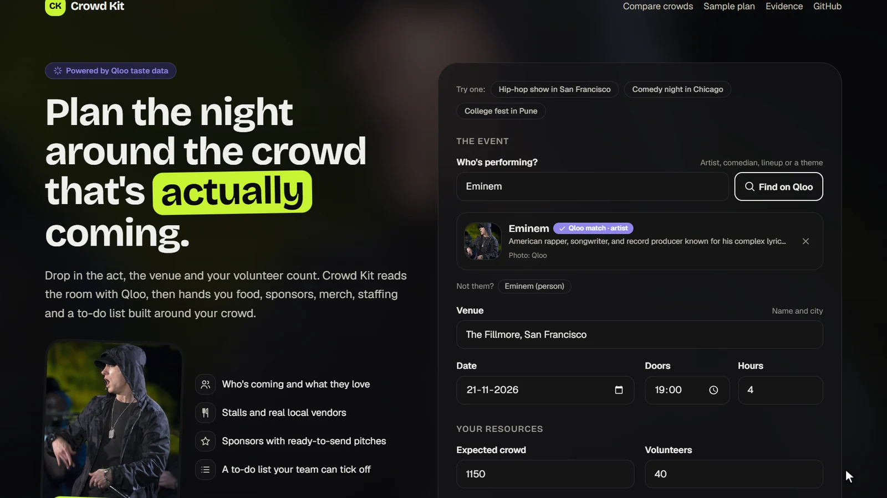
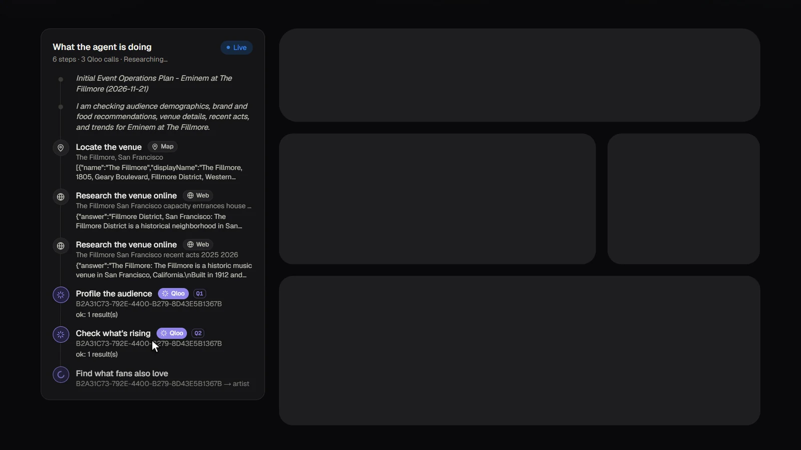
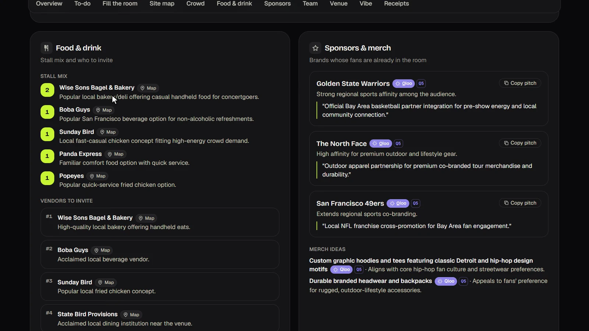
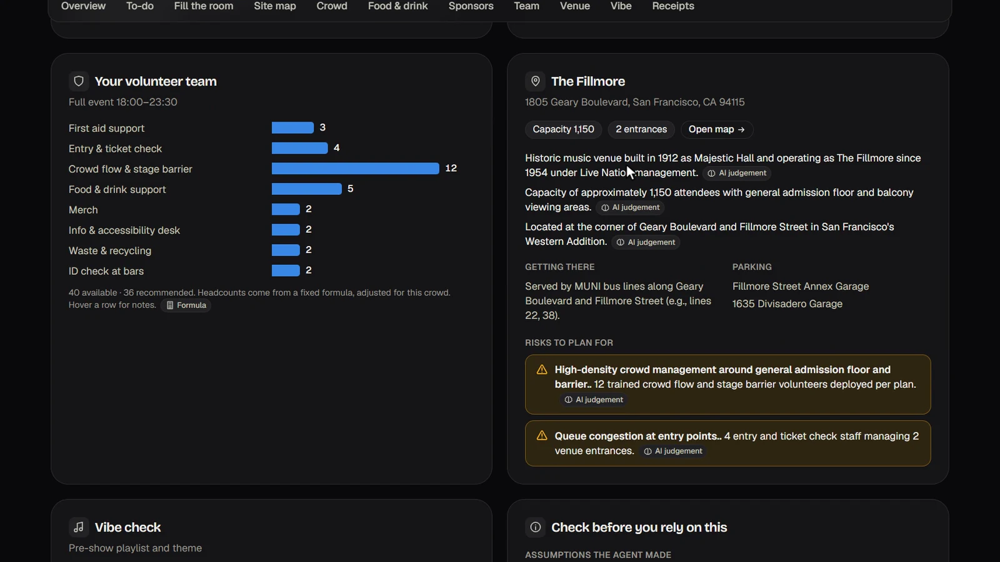
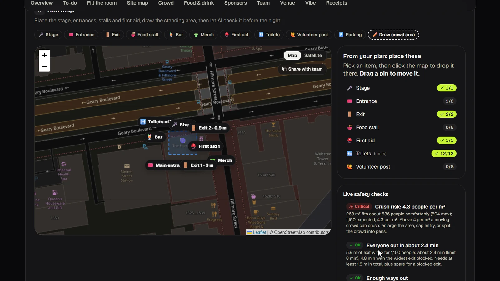
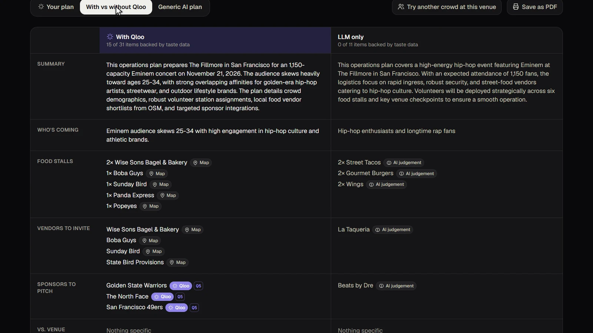
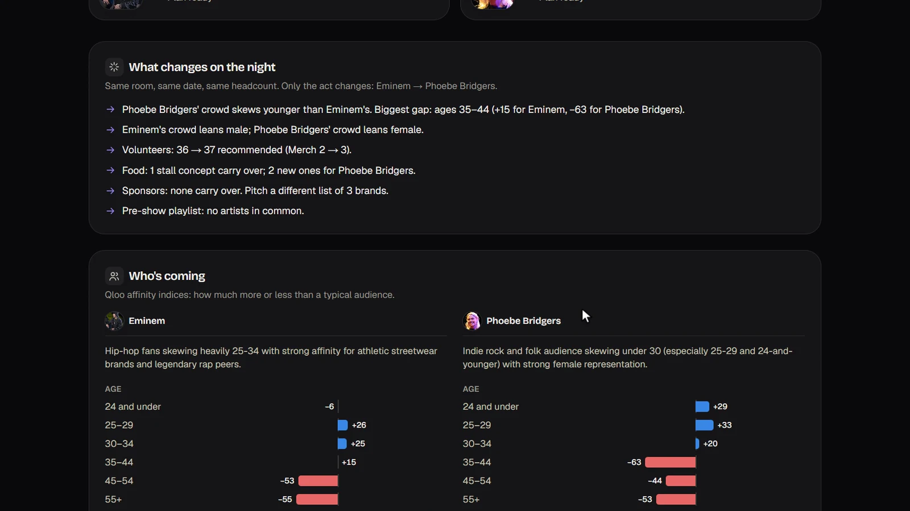
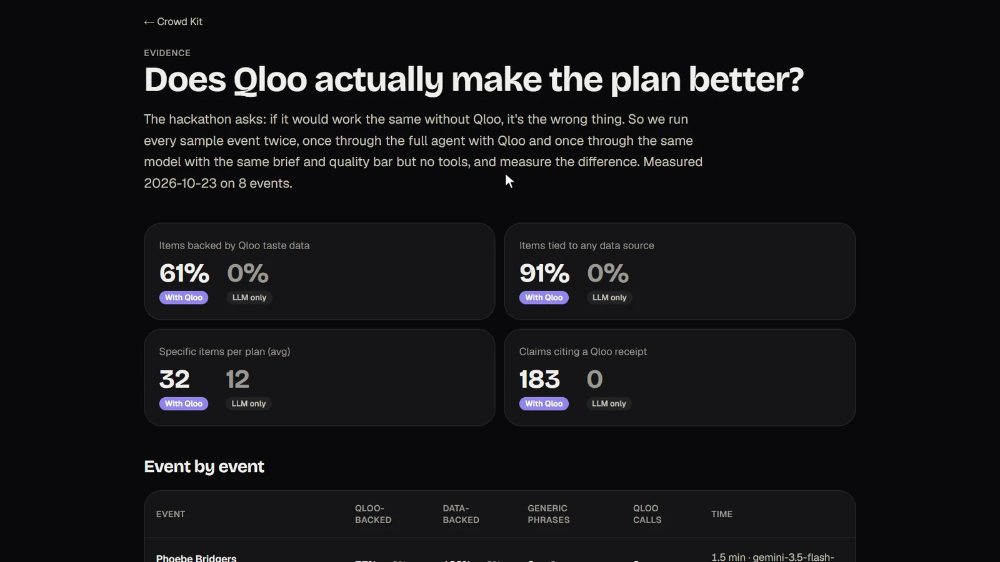

<div align="center">

# Crowd Kit

### Plan the night around the crowd that's actually coming.

An AI agent that turns [Qloo](https://qloo.com)'s taste data into food, sponsor, merch, staffing and site plans for gigs, comedy nights and college fests.

[](https://crowd-kit.onrender.com)
[](https://crowd-kit.onrender.com/evidence)
[](LICENSE)



[Live app](https://crowd-kit.onrender.com) · [Finished sample plan](https://crowd-kit.onrender.com/sample) · [Same venue, different crowd](https://crowd-kit.onrender.com/crowds) · [Evidence](https://crowd-kit.onrender.com/evidence) · [How we built it](docs/sdlc.md)

<sub>Built for the <a href="https://qloo.devpost.com/">Qloo Agentic Hackathon</a> by Aditya, Ayush and Om.</sub>

</div>

---

## Why

People who run gigs, comedy nights and college fests make the same expensive bets every time: which food stalls to book, which sponsors to pitch, what merch to print, how many volunteers to put on the door, and where the exits and first aid go. Most of it is gut feel. A stall nobody visits is wasted money, a sponsor that doesn't fit the crowd says no, and a badly laid-out site causes crushes and queues.

Qloo already knows, in aggregate, what fans of an act eat, wear and listen to. Crowd Kit turns that into a plan an organiser can act on, and shows its working.

## What it does

<table>
<tr>
<td width="50%" valign="top">

<h4>An agent that shows its working</h4>
Enter the act, venue, date, crowd size and volunteers. The agent asks Qloo who the fans are, what they love and how they differ from the venue's usual crowd, while it maps the venue, transit, nearby food and the weather. Every step is visible as it happens.
</td>
<td width="50%" valign="top">

<h4>A plan you can act on</h4>
A stall mix that fits your slots, with real nearby vendors ranked for this crowd. Sponsors whose fans are already in the room, each with a ready-to-send pitch. Every line shows its source, and Qloo-backed lines link to a <b>receipt</b>: the exact Qloo call behind them.
</td>
</tr>
<tr>
<td width="50%" valign="top">

<h4>Staffing you can defend</h4>
Volunteer stations and shifts come from published crowd-safety guidance (Purple Guide, Green Guide, NFPA 101), never from the model. Safety stations are filled first when you're short, and Qloo's age profile sets the merch and accessibility weights in code.
</td>
<td width="50%" valign="top">

<h4>A site map that checks itself</h4>
Place the stage, exits, stalls and first aid on a real map. Live checks flag crowd density (a crush warning above 4 people per m²) and how long it takes to get everyone out, even with the widest exit blocked. An AI layout review catches the rest.
</td>
</tr>
<tr>
<td width="50%" valign="top">

<h4>Proof the data matters</h4>
The same model and brief with no tools, side by side. Without Qloo you get generic guesses; with Qloo, named vendors and sponsors, each traced to data.
</td>
<td width="50%" valign="top">

<h4>Same venue, different crowd</h4>
Pick two acts for one venue, such as Eminem vs Phoebe Bridgers at The Fillmore, and see what changes on the night: who's coming, staffing by station, food, sponsors, merch and the playlist.
</td>
</tr>
</table>

Also in every plan: a to-do list your team can tick off, "Fill the room" promotion ideas for shows with seats left, a pre-show playlist, and a print-ready PDF.

## Does Qloo actually help?

We plan 8 real events (US, UK and India; music, comedy and a college fest) twice: once with Qloo, and once with the same model, brief and quality bar but no tools.

| Measured on 8 events | With Qloo | Same model, no Qloo |
|---|:---:|:---:|
| Plan items backed by Qloo taste data | **61%** | 0% |
| Items tied to a data source | **91%** | 0% |
| Specific items per plan | **32** | 11.5 |
| Claims citing a Qloo receipt | **183** | 0 |



The evaluation also made the agent better: a free-text audience filter made Qloo ask for clarification 36 times across the 8 events, and removing it brought that down to 2. Method and per-event results: [/evidence](https://crowd-kit.onrender.com/evidence) and [docs/qloo-evidence.md](docs/qloo-evidence.md).

## How Qloo is used

All Qloo access goes through Qloo's hackathon harness (`qloo mcp`), which Crowd Kit starts as a local MCP server and hands to the agent as tools.

| Qloo workflow | What Crowd Kit does with it |
|---|---|
| `qloo_describe`, `qloo_find_tags` | Resolve the act or theme to Qloo IDs. If a match is ambiguous (`needs_input`), the agent records its choice as an assumption for the planner to check. |
| `qloo_audience_demographics` | Crowd profile: age and gender, which also sets the staffing weights |
| `qloo_recommend` | Brands, local places and artists that the act's fans over-index on |
| `qloo_compare_audiences` | Tonight's crowd vs the venue's usual crowd |
| `qloo_rank` | Rank **real** shortlists (nearby vendors, candidate sponsors) for this audience |
| `qloo_where_popular` | Neighbourhoods where this crowd stands out, for "Fill the room" promotion |
| `qloo_trends` | Rising artists for the pre-show playlist |

## How it works

```
Browser form ──POST /api/plan?mode=qloo────▶ Gemini agent (function calling)
     ▲                                          │
     │  Server-Sent Events                       ├─ qloo_* workflows via `qloo mcp` (MCP stdio)   (Qloo)
     │  (live trace + final plan)                ├─ geocode_venue / nearby_osm                  (OpenStreetMap, Photon fallback)
     │                                          ├─ weather_for_date                            (Open-Meteo)
     │                                          ├─ web_search                                  (Gemini + Google Search, or Wikipedia)
     │                                          ├─ plan_volunteers                             (deterministic formula)
     └──────────────────────────────────────────└─ submit_plan → Plan JSON
Browser form ──POST /api/plan?mode=baseline──▶ Gemini, no tools ("Without Qloo")
```

- **Code computes, the model explains.** Headcounts, safety checks and promotion hot spots are calculated; the model picks and writes the words.
- **Honesty is enforced in code.** A plan is rejected if it labels something "Qloo" that no Qloo call returned, or uses a source whose tool failed in that run.
- **Typed plans.** Zod schemas define the plan; `submit_plan` validates it and sends errors back for the agent to fix.
- **Built for the free tier.** Every Gemini call has a time limit and falls back through several models; identical events replay from a server-side cache, and only clean runs are saved.

| Path | What it is |
|---|---|
| `src/lib/types.ts` | **Shared contracts:** `EventInput`, `Plan`, `ToolResult`, `AgentEvent`. Tell the team before you change them. |
| `src/lib/agent.ts` | Gemini agent loop, tool wiring, baseline |
| `src/lib/prompt.ts` | The agent's system prompt |
| `src/lib/tools/qloo.ts` | Starts `qloo mcp`, exposes its workflows to the agent, handles mock mode |
| `src/lib/tools/geo.ts` | Geocoding, nearby places and weather |
| `src/lib/tools/wiki.ts` | Wikipedia fallback for web search |
| `src/lib/tools/staffing.ts` | Volunteer formula, with sources for every ratio. The LLM never invents headcounts. |
| `src/lib/layout.ts` | Site map safety checks |
| `src/lib/cache.ts` | Server-side response cache (OS temp folder by default, never in the repo) |
| `src/app/api/plan/route.ts` | Streaming API route |
| `src/components/CrowdKit.tsx` | Form, live trace and plan view |

## Running locally

Requires **Node.js 22.19 or newer**.

```bash
# 1. Qloo's event harness (the supported way to reach Qloo; see qloo/qloo-hackathon-kit)
npm install --global @qloo/qloo-harness
qloo config set base-url https://hackathon.api.qloo.com   # hackathon keys are rejected by the default (production) server
qloo setup --qloo            # paste the event credential once; it stays in qloo's private config
qloo setup --status

# 2. The app
npm install
cp .env.example .env.local   # add GEMINI_API_KEY (free: https://aistudio.google.com/apikey)
npm run dev                  # http://localhost:3000
```

| Variable | Required | Notes |
|---|---|---|
| `GEMINI_API_KEY` | yes | Gemini runs the agent loop (free tier: `gemini-3.5-flash-lite` by default, web search via `gemini-2.5-flash`). Identical events are replayed from a server-side cache, so they use no requests |
| `GEMINI_SEARCH_API_KEY` | no | Free Google Search only works on `gemini-2.5-flash`, which newer keys can't use. Set an older key here for web search; otherwise it falls back to Wikipedia, and pauses for 15 minutes if Wikipedia rate-limits the server. |
| `QLOO_API_KEY` | on servers | Locally, `qloo setup --qloo` is enough. With no usable credential, or without `qloo` installed, Qloo tools return clearly labelled **mock** data. |
| `CROWDKIT_CACHE_DIR` | no | Where the response cache is written (default: the OS temp folder, `crowdkit-cache`; kept out of the project so the dev server doesn't reload). Docker image sets `/app/.cache`. |
| `QLOO_BASE_URL`, `QLOO_TRUSTED_BASE_URL` | set in the image | Hackathon keys only work on `https://hackathon.api.qloo.com`. The Dockerfile sets both. Locally, run `qloo config set base-url https://hackathon.api.qloo.com` once. |
| `QLOO_BIN` | no | Full path to `qloo` if it isn't on PATH (Windows: `where.exe qloo`) |

OpenStreetMap (Nominatim, Overpass, Photon) and Open-Meteo need no keys.

## Deploying

`qloo mcp` is a local stdio process, and Qloo's kit says serverless functions are not supported. So we deploy as **one Docker container** on Render, Railway or Fly.io:

```bash
docker build -t crowd-kit .
docker run -p 3000:3000 -e GEMINI_API_KEY=... -e QLOO_API_KEY=... crowd-kit
```

On the host, set both keys as secrets in the dashboard. Never put them in the repo or the image. `GET /api/health` returns `{ ok, demo, qloo: "live" | "mock", reason? }` (it also warms `qloo mcp`); check that `qloo` says `live`.

**Render** (`render.yaml`):
1. Push the repo, then in Render choose **New > Blueprint** and select it.
2. Enter `GEMINI_API_KEY` and `QLOO_API_KEY` when prompted (or later under Environment).
3. Deploy. The blueprint uses the free plan, which spins down after 15 idle minutes (the next visit takes about a minute). Switch to `starter` for always-on.

Our live app deploys from GitHub Actions: every push to `main` that changes code calls the Render deploy hook (repository secret `RENDER_DEPLOY_HOOK`; pushes that only touch docs are skipped), and a second workflow pings `/api/health` every 10 minutes so the free plan stays awake.

**Fly.io** (`fly.toml`):
```bash
fly launch --no-deploy --copy-config   # pick a unique app name
fly secrets set GEMINI_API_KEY=... QLOO_API_KEY=...
fly deploy
```
The config keeps one machine always running (no cold starts) and health-checks `/api/health`.

No keys yet? Set `CROWDKIT_DEMO=1` for a keyless deploy that replays canned data. To keep the Qloo cache across deploys, mount a disk at `/app/.cache` (or point `CROWDKIT_CACHE_DIR` elsewhere); see the commented blocks in `render.yaml` / `fly.toml`.

## Team

| Who | Owns |
|---|---|
| Aditya | Agent and Qloo integration, Devpost write-up |
| Ayush | Product and frontend |
| Om | Venue research tools, staffing formula, caching, deploys |

## Known limitations

- Qloo results describe **aggregate audience affinities**. They are not predictions about any individual attendee, and the plan words them that way.
- The agent runs on the Gemini API free tier, so a new plan usually takes 1–2 minutes. Google may use free-tier requests to improve its products, so don't enter anything private.
- Venue facts from web search can be out of date, and web search pauses for a while if Wikipedia rate-limits the server. The plan labels web facts `web` and lists any gaps under limitations.
- The volunteer formula follows published minimums (Purple Guide, Green Guide, NFPA 101; sources in `src/lib/tools/staffing.ts`) where they exist, and rules of thumb for food, merch, the info desk and bar ID checks. It supports, and never replaces, professional safety staffing.
- Public OpenStreetMap servers are sometimes overloaded. When they fail, the plan says so instead of guessing.

## Rules we follow

- **Never commit Qloo response data or API keys.** The cache lives outside the repo (OS temp folder, or `CROWDKIT_CACHE_DIR`).
- **Never send personal data to Qloo.** Inputs are public venues, acts and themes.
- Every recommendation carries a `source` (`qloo`, `web`, `osm`, `weather`, `calc`, `llm` or `mock`).

More: [how we planned, built, tested and deployed Crowd Kit](docs/sdlc.md) · [Devpost write-up](docs/devpost.md) · [contributing](CONTRIBUTING.md)

## License

[MIT](LICENSE)
